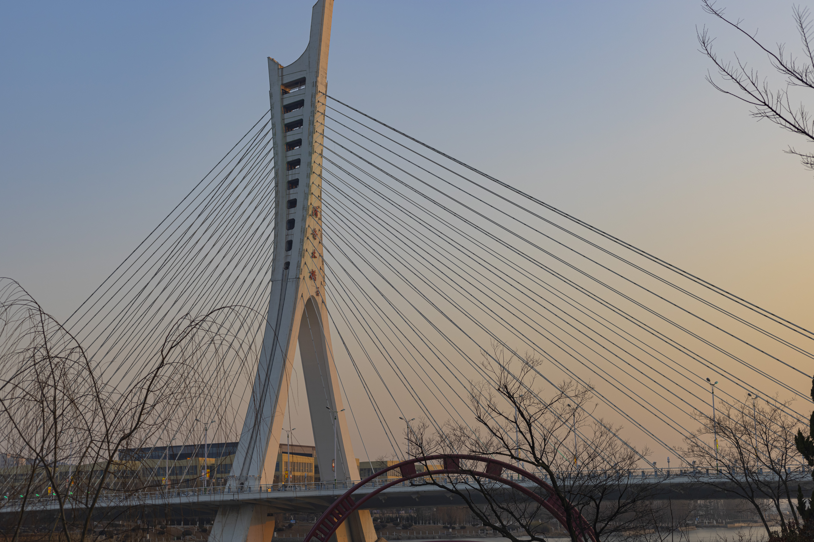
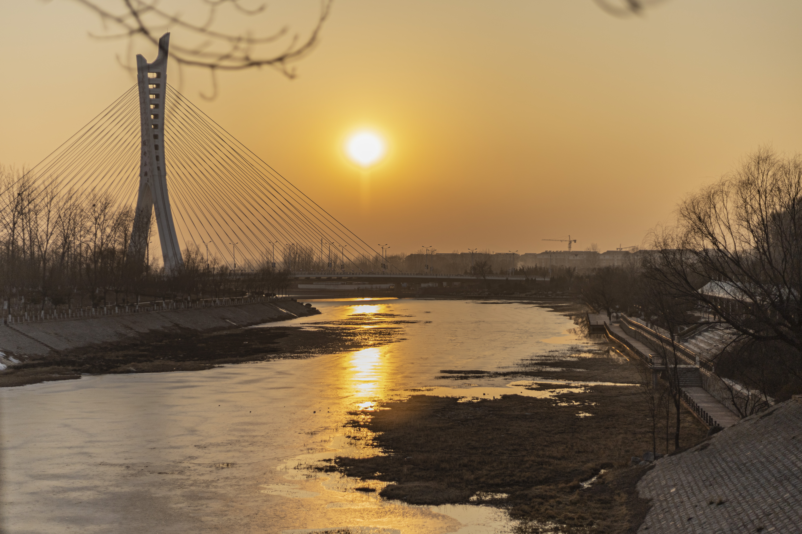
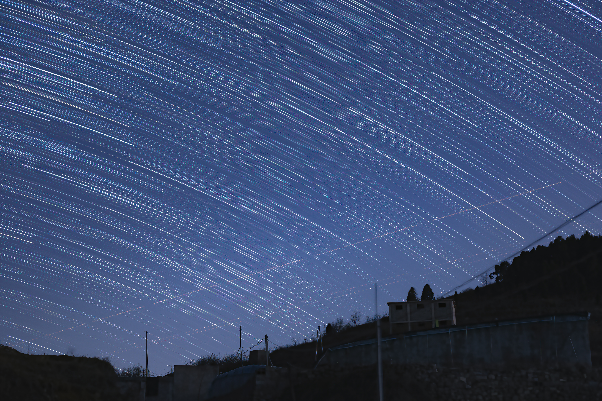
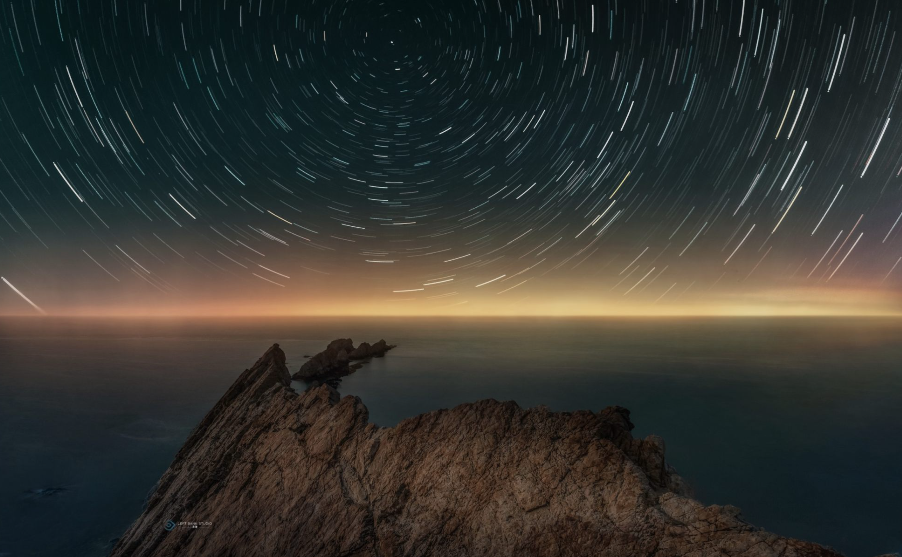



在上学期马上要结束时，我动了换相机的邪念，这邪念最终导致我的钱包缩水，我的相机也由尼康家的D3500换成了佳能家Eosrp。鉴于我以前假期在家都是高强度娱乐，带回去的书往往就呆在行李箱睡大觉，这次我便将新购的相机和三脚架一并带回了家，<strong>万一自己在家想出去拍拍照呢？</strong>

因为疫情原因，我也就在家周围拍了拍，就藉这篇文章简单地分享下自己拍的一些照片，然后介绍下星轨照片和延时视频制作的流程吧。 

<h4 id="影像记录">影像记录</h4>
   

<h4 id="延时视频">延时视频</h4><ul>
<li>
公园延时摄影

  <iframe src="//player.bilibili.com/player.html?aid=501747233&amp;bvid=BV1BN411X7oM&amp;cid=298163667&amp;page=1&amp;&amp;high_quality=1" scrolling="no" border="0" frameborder="no" framespacing="0" allowfullscreen="true" width="100%" height="520"> </iframe>

</li>
<li>
星空延时摄影 

  <iframe src="//player.bilibili.com/player.html?aid=586696451&amp;bvid=BV1uz4y127zS&amp;cid=298721215&amp;page=1&amp;&amp;high_quality=1" scrolling="no" border="0" frameborder="no" framespacing="0" allowfullscreen="true" width="100%" height="520"> </iframe>

<h5 id="简要介绍">简要介绍</h5>
哪怕大家对延时摄影这个概念非常模糊，但肯定见过与上面两个视频类似的视频，延时摄影当可以将斗转星移、日升日落、云彩飘动压缩到短短的十几秒视频中，所带来的视觉体验还是神奇的， 首先给出延时摄影的定义: 

<blockquote>

<strong>延时摄影:</strong> 延时摄影，又叫缩时摄影、缩时录影，是以一种将时间压缩的拍摄技术。其拍摄的通常是一组照片，后期通过将照片串联合成视频，把几分钟、几小时甚至是几天的过程压缩在一个较短的时间内以视频的方式播放。

</blockquote>
</li>
</ul>
<h5 id="计算公式">计算公式</h5>
延时摄影可以为我们带来平日所接触不到的视觉体验，其原理也是非常简单的，只需要明确以下几点: 

<blockquote>
<ul>
<li><strong>视频:</strong> 视频其实就是一系列图片堆栈而成，若想让视频看起来流畅，则一秒钟至少需要有24帧图像。</li>
<li><strong>客观世界时长:</strong> 假设我们以高速快门间隔$t_p$s进行拍摄，最终拍摄时长为$ts$，则$t$就是客观世界所经历的时间，而所拍摄的照片张数为$a = \frac{t}{t_p}$。</li>
<li><strong>视频时长:</strong> 若视频帧数为24fps，那么若用相机拍摄的$a$张照片来制作延时视频，那么视频时长就是$t_v = \frac{a}{24}s$。 </li>
</ul>
</blockquote>

由此，基于照片张数这样一个桥梁，我们就建立了如下一个等式: 

比如我们想以固定间隔时间$t_p = 10s$， 想拍一个10$s$的视频，那么实际在进行间隔拍摄时就需要拍摄$t = 24<em>t_v</em>t_p = 2400s = 40 min$。这样就实现了将$40min$客观世界的变化压缩到了$10s$的视频内。但如果是慢门拍摄则在间隔时间里需要将曝光时间也算进去。 

<h5 id="拍摄方法">拍摄方法</h5>
拍摄方法一般有三种: 

<ul>
<li>对于没有机内延时的相机，则需要借助快门线来实现间隔拍摄的功能。</li>
<li>间隔拍摄: 直接根据自己的需求来计算间隔时间和拍摄时间，然后将图片导出后导入PR来输出延时视频(教程很多)。 </li>
<li>延时视频: 现在很多相机都内置延时短片功能，设置拍摄间隔和拍摄张数，便可直出延时视频，省去了将图片堆栈成延时视频这一步。 </li>
</ul>
<h4 id="星轨拍摄">星轨拍摄</h4><h5 id="简要介绍-1">简要介绍</h5><blockquote>

<strong>星轨:</strong> 星轨其实是我们地球自身自转的反射，在拍摄过程中，我们的相机机位在地球上相对位置并未发生变化，但由于有地球自转存在，我们会观测到星星不断移动，形成一个圆形，而圆心就是我们自转的主轴所指向的无穷远处。 

</blockquote>

<h5 id="星轨拍摄-1">星轨拍摄</h5>
星轨拍摄需要慢门，但在实现上有两种思路: 

<blockquote>
<ul>
<li>直接采用B门定时拍摄，设置$10min$以上的曝光时间，然后拧动对焦环到无穷远处，最后调整曝光参数以保证最终图片恰当曝光，曝光参数可能需要多次尝试后确定，当拍摄环境并不够黑暗时，这种思路很难实现，因为长曝光会导致成片一片死白。 </li>
</ul>
</blockquote>

<blockquote>
<ul>
<li>间隔拍摄，然后后期堆栈，比如我想拍30min时长所形成的星轨，那么我可以连续拍摄多个星空照片，然后后期进入PS，使用最大值堆栈进行星轨合成。 </li>
</ul>
</blockquote>

<blockquote>

<strong>tips:</strong> 记得关闭相机的长曝光降噪。 

</blockquote>

我比较推荐第二种方法，因为参数更容易设置，同时后期空间更大，试错成本更低。 


