

这一篇文章就跟随校风光摄影的大佬来了解一下风光摄影的一些知识，该部分按照以下三部分进行组织: 

<ul>
<li>风光摄影拍什么 </li>
<li>前期工作 </li>
<li>实用技术 
</li>
</ul>
<h3 id="风光摄影拍什么">风光摄影拍什么</h3><h4 id="校园摄影">校园摄影</h4>
在清华园里可以拍什么景色: 

<ul>
<li>四季景观 </li>
<li>日出月落 </li>
<li>人文活动 </li>
<li>校园地标 </li>
</ul>
<h5 id="四季景观">四季景观</h5><ul>
<li>
春 <strong>春$\cdot$樱花友谊林</strong> 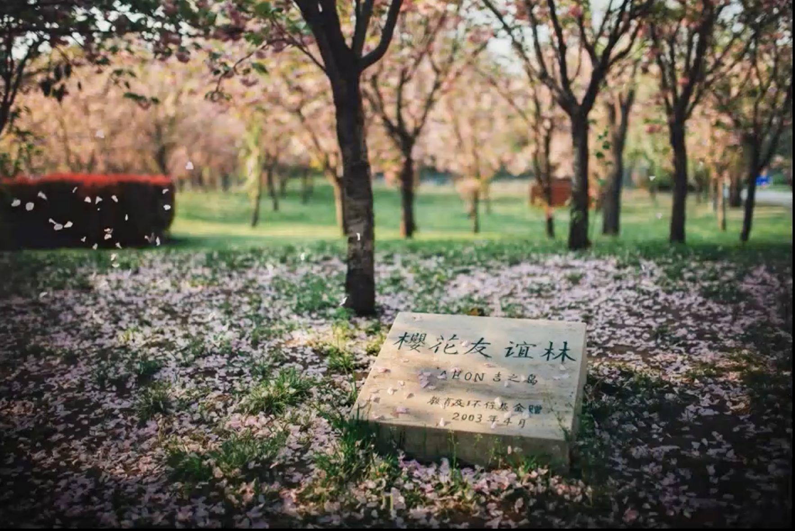

</li>
<li>
夏 晚霞，5月25日前后 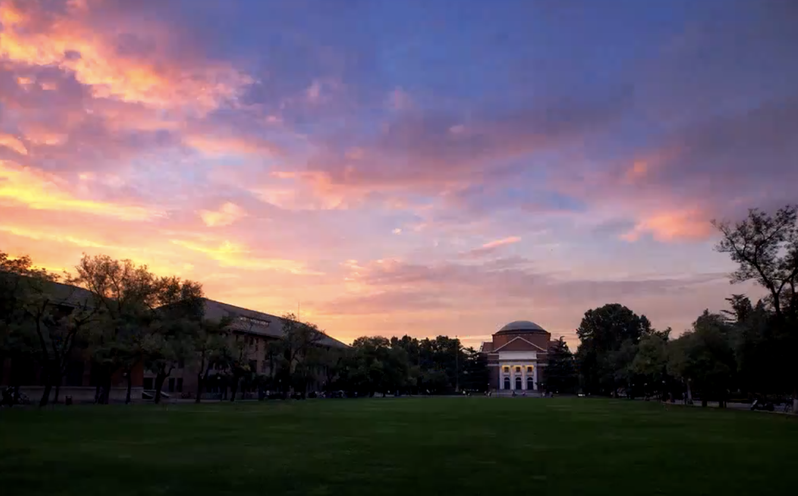 

</li>
<li>
秋 银杏，二校门前,雕塑苑  爬山虎,红叶,工字厅门前 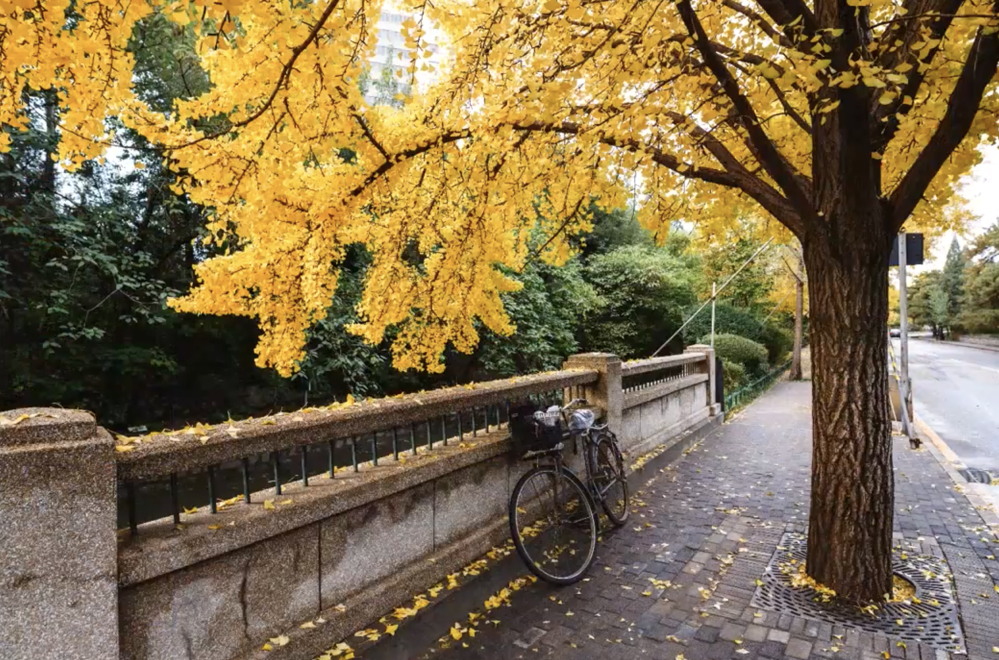

</li>
<li>
冬 清华学堂，水木清华，大礼堂，夜里下雪开闪光灯，情人坡 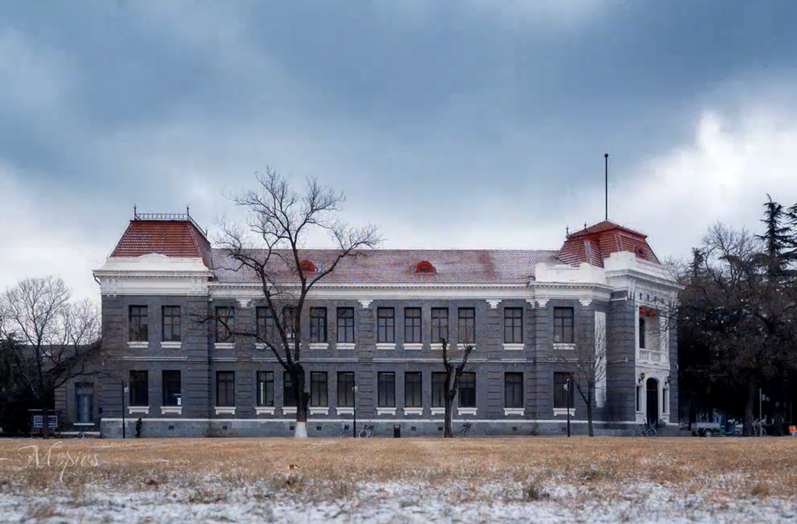 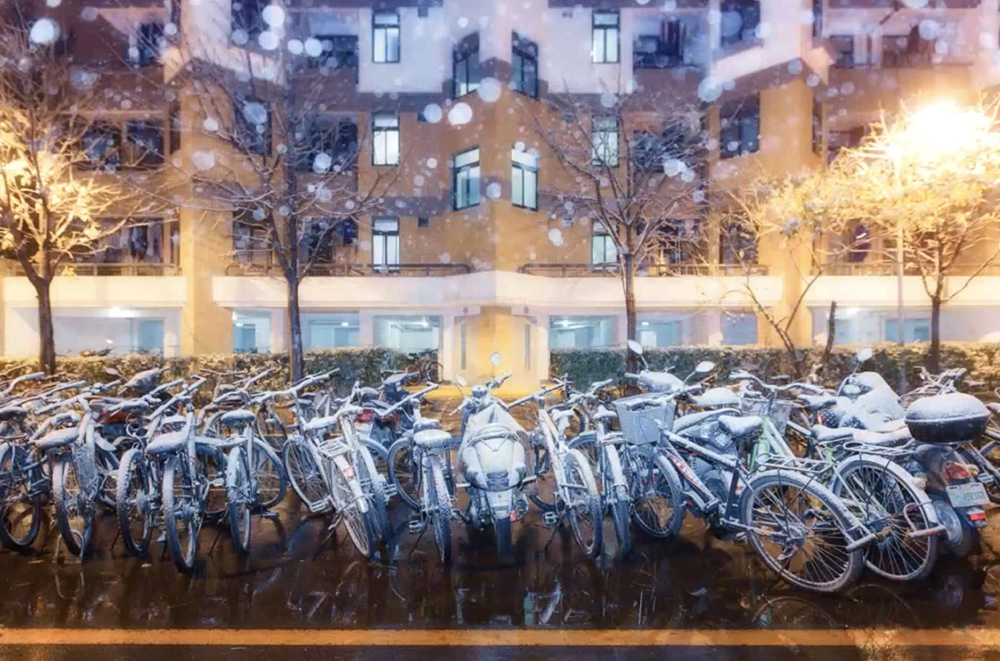

</li>
</ul>
<h5 id="日出月落">日出月落</h5>
晨雾,头一天下过雨 拍星轨比较推荐: 西操 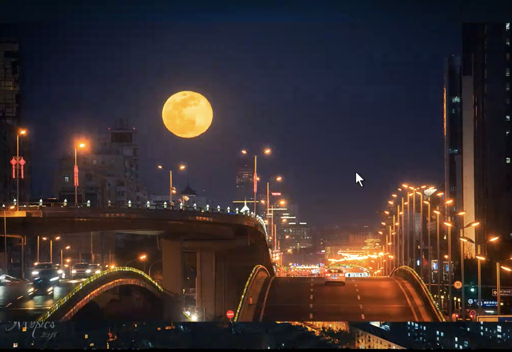

<h5 id="人文活动">人文活动</h5>
文图、猫猫、路牌、校庆期间、高1楼、艺博

<h4 id="城市摄影">城市摄影</h4>

<h4 id="旅行摄影">旅行摄影</h4>
主要拍地标

<h4 id="星空摄影">星空摄影</h4>
银河、星轨、流星雨、银河拱桥 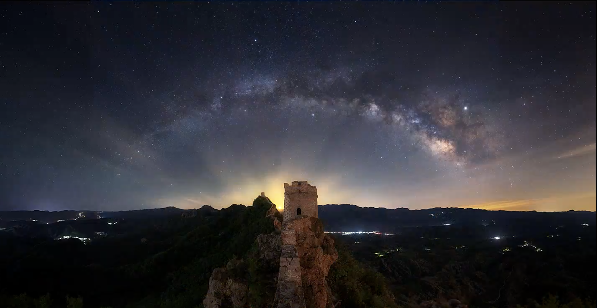

<h4 id="延时摄影">延时摄影</h4>
加上了时间的维度，比较震撼 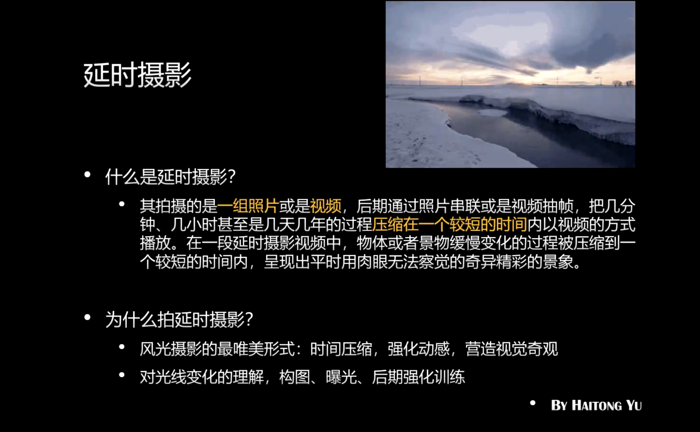

<h3 id="前期准备">前期准备</h3><h4 id="摄影计划">摄影计划</h4><ul>
<li>挑选样片 500px, 图虫<ul>
<li>寻找灵感 </li>
<li>同机位复现</li>
<li>原创性 </li>
</ul>
</li>
<li>查找机位 <ul>
<li>确认图片位置 </li>
<li>预估交通时间</li>
<li>通过EXIF信息确认焦段 </li>
<li>确认拍摄位置可前往</li>
</ul>
</li>
<li>确认天气 <ul>
<li>天气预报软件: 彩云天气、墨迹天气 </li>
<li>Windy: 云图 </li>
<li>莉景天气 </li>
<li>plan it(巧摄)</li>
</ul>
</li>
<li>整备器材 </li>
</ul>
<h4 id="现场判断与操作">现场判断与操作</h4><ul>
<li>焦段选择</li>
<li>
拍摄方式 

<ul>
<li>多帧堆栈 </li>
<li>全景拼接 <ul>
<li>拼接接缝 </li>
<li>使用三脚架</li>
<li>参数尽量一致</li>
</ul>
</li>
</ul>

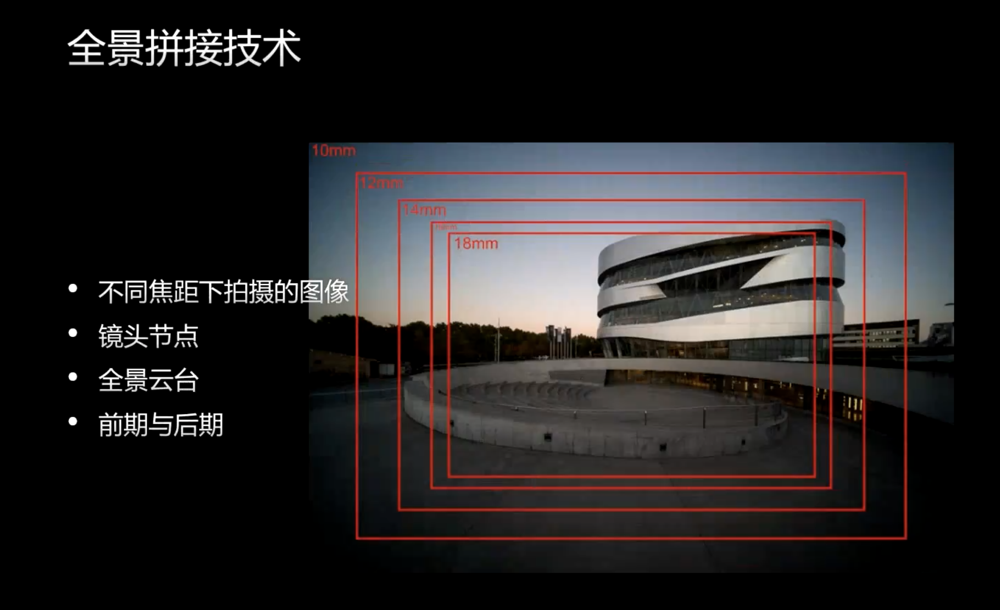

<ul>
<li>景深合成 拍摄出全景深图片</li>
<li>延时摄影 <ul>
<li>拍摄间隔</li>
<li>尽量拍摄长时间，广角</li>
</ul>
</li>
</ul>
</li>
<li>
如何拍出一张完美的前期 

<ul>
<li>多拍几张，防止抖动</li>
<li>通过不同参数，拿到画面的不同部分 </li>
<li>留下足够多裁剪空间  </li>
</ul>
</li>
<li>
超广角镜头 

<ul>
<li>通常指20mm焦段以下镜头</li>
<li>16-35mm</li>
<li>透视，近大远小</li>
<li>引导线构造</li>
<li>前景、中景、远景</li>
</ul>
</li>
<li>
HDR-High dynamic range 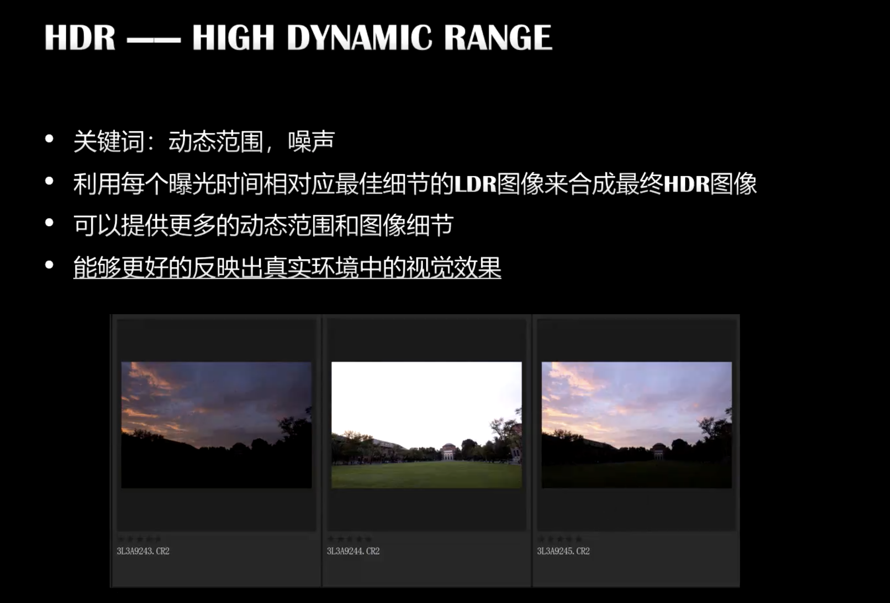 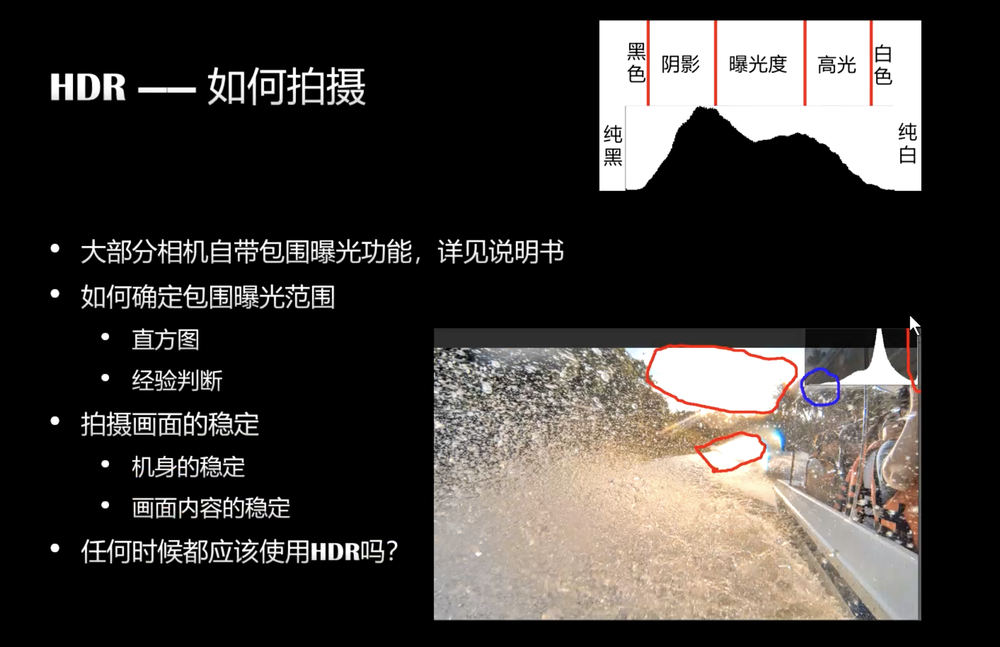

</li>
<li>
前期与后期的关系 

<ul>
<li>前期服务于后期 </li>
<li>后期依赖于前期</li>
</ul>
</li>
</ul>
<h3 id="晚霞怎么拍">晚霞怎么拍</h3><ul>
<li>夏季为晚霞多发的季节 </li>
<li>地景选择 <ul>
<li>地面机位</li>
<li>爬楼 </li>
</ul>
</li>
<li>逆光环境下的拍摄方法</li>
</ul>
<h3 id="朝阳怎么拍">朝阳怎么拍</h3><ul>
<li>选择合适的拍摄点 </li>
<li>特写/局部/大场景</li>
<li>鬼影的解决方案 </li>
</ul>

